


<!-- The portrait floats left; the card is right-aligned beside it. Both are 48%
     wide so their frames line up with the header's at any width. The card is
     sliced so its buttons can be links: the pieces stack with align="top" (no
     line gaps) and must stay on these lines with no spaces. -->

<picture><source media="(prefers-color-scheme: dark)" srcset="assets/portrait-dark.svg"></picture>
<picture><source media="(prefers-color-scheme: dark)" srcset="assets/intro/card-top-dark.svg"></picture> 
<a href="https://www.linkedin.com/in/esam-alareqi9027b230a"><picture><source media="(prefers-color-scheme: dark)" srcset="assets/intro/link-linkedin-dark.svg"></picture></a><a href="mailto:esammostafa9@gmail.com"><picture><source media="(prefers-color-scheme: dark)" srcset="assets/intro/link-gmail-dark.svg"></picture></a><a href="https://www.kaggle.com/esamalareqi"><picture><source media="(prefers-color-scheme: dark)" srcset="assets/intro/link-kaggle-dark.svg"></picture></a><a href="https://www.credly.com/users/esam-mustafa-ali-abduljalil-al-areqi"><picture><source media="(prefers-color-scheme: dark)" srcset="assets/intro/link-credly-dark.svg"></picture></a><a href="https://github.com/esammostafa9-cloud?tab=repositories"><picture><source media="(prefers-color-scheme: dark)" srcset="assets/intro/link-github-dark.svg"></picture></a> 
<picture><source media="(prefers-color-scheme: dark)" srcset="assets/intro/card-bottom-dark.svg"></picture>

 


## About

I am an AI engineer in training, focused on building agentic systems that hold up in production. My work centres on multi-agent workflows, retrieval-augmented generation and model evaluation: designing agents that plan, use tools and work with external services, grounding them in reliable retrieval, and measuring how they behave so that their outputs can be trusted.

I am in my third year of a Bachelor of Computer Science, specialising in Artificial Intelligence and Data Science, at Taylor's University in Kuala Lumpur, with a solid foundation in machine learning, deep learning and computer vision. I am currently seeking industrial training or an internship in AI engineering, where I can contribute to real products and keep growing alongside experienced engineers.

## Featured Projects

<table>
<tr><th width="18%">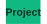</th><th width="62%"></th><th width="20%"></th></tr>
<tr><td><b>Nabily</b> <i>(co-founder, private)</i></td><td>Agentic platform that checks whether student deals and discounts are still valid in real time. AI agents run the workflows and third-party API integrations behind a TypeScript web app.</td><td>TypeScript, Python, LangGraph, Neon PostgreSQL</td></tr>
<tr><td><b>Collabwisely</b> <i>(group capstone, private)</i></td><td>Multiplayer AI workspace where a team and its AI agents plan, build and review together, with a verifiable record of who did what. In active development.</td><td>Next.js, FastAPI, LangGraph, PostgreSQL</td></tr>
<tr><td><b>Sentinel RAG</b></td><td>Natural-language Q&amp;A over multiple PDFs, powered by Llama 3.3 70B through the Groq API. Local BGE embeddings and a persistent ChromaDB store behind a FastAPI backend and a custom frontend. Deployment to Render in progress.</td><td>Python, LangChain, Groq, ChromaDB, FastAPI</td></tr>
<tr><td><a href="https://github.com/6rzan/The-Council">The Council</a> <i>(team of 4)</i></td><td>Google and Kaggle AI Agents capstone. Recruits an expert panel, runs a structured debate, fact-checks claims through MCP and synthesizes a verdict.</td><td>Python, Google ADK, Gemini, MCP, FastAPI</td></tr>
<tr><td><b>Hotel Booking Cancellation Predictor</b></td><td>Predicts cancellations at booking time from 119,390 records, after removing 5 leakage features, duplicates and 747 invalid entries. Random Forest reached ROC-AUC 0.883; threshold tuning raised recall from 0.56 to 0.74.</td><td>Python, scikit-learn, Pandas</td></tr>
<tr><td><b>FloraVision</b> <i>(private)</i></td><td>ResNet-50 transfer learning on about 3,670 images across 5 flower classes, trained in two phases to 92% test accuracy. Deployed as a public Gradio app on Hugging Face Spaces.</td><td>TensorFlow, Keras, Gradio</td></tr>
<tr><td><a href="https://github.com/esammostafa9-cloud/resisc45-scene-classification">Satellite Image Classification</a></td><td>Fine-tuned ResNet-50 that sorts satellite images into the 45 land-use classes of NWPU-RESISC45, at 94.41% test accuracy.</td><td>Python, TensorFlow, Keras</td></tr>
</table>

## Experience & Education

**Co-founder** · Nabily · *Sep 2026 – present* 
Architected the agent-based backend, where AI agents orchestrate workflows and third-party API integrations, with a TypeScript web app and a Neon PostgreSQL database.

**Bachelor of Computer Science (Artificial Intelligence & Data Science)** · Taylor's University, Kuala Lumpur · *Third year* <!-- TODO: add expected graduation year -->

- Coursework in machine learning, deep learning, computer vision, databases and software engineering.
- Group capstone: Collabwisely, a multiplayer AI workspace.

## Tech Stack

<table>
<tr><th width="19%"></th><th width="81%"></th></tr>
<tr><td><b>Languages</b> Core programming</td><td>

</td></tr>
<tr><td><b>Machine Learning</b> Training and evaluation</td><td>

</td></tr>
<tr><td><b>AI Engineering</b> LLMs, agents and RAG</td><td>

<a href="https://gemini.google.com">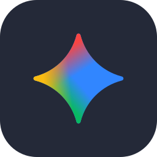</a>
<a href="https://www.llama.com">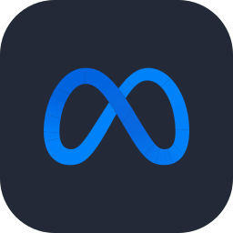</a>

<a href="https://openrouter.ai">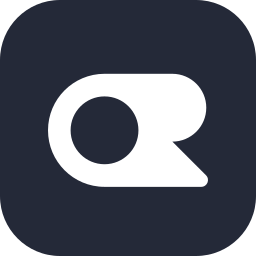</a>
<a href="https://openai.com">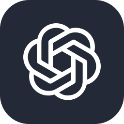</a>
 
<a href="https://www.langchain.com">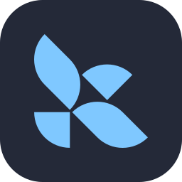</a>
<a href="https://www.langchain.com/langgraph">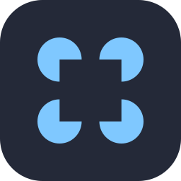</a>
<a href="https://n8n.io">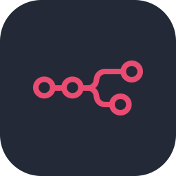</a>

<a href="https://www.langchain.com/langsmith">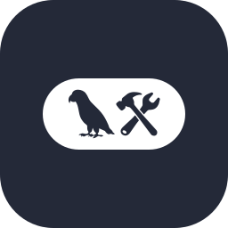</a>

 

<a href="https://www.trychroma.com">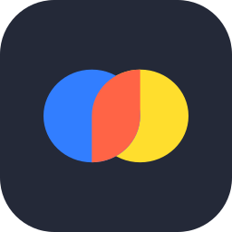</a>
<a href="https://huggingface.co/BAAI">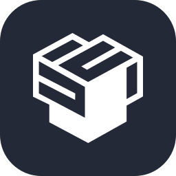</a>
</td></tr>
<tr><td><b>AI Coding Tools</b> Agentic development</td><td>

<a href="https://cursor.com">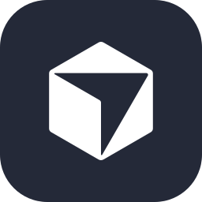</a>

<a href="https://openai.com/codex">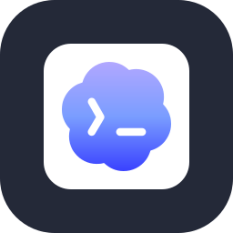</a>
<a href="https://antigravity.google">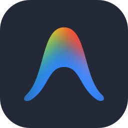</a>
</td></tr>
<tr><td><b>Data &amp; Databases</b> Analysis, visualisation and storage</td><td>
<a href="https://pandas.pydata.org">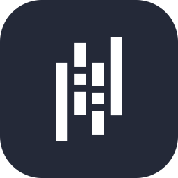</a>
<a href="https://numpy.org">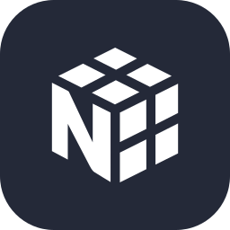</a>

<a href="https://neon.com">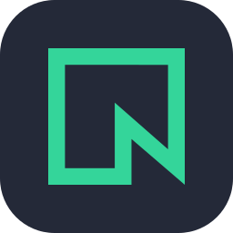</a>
<a href="https://matplotlib.org">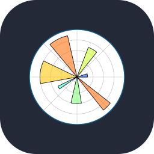</a>

</td></tr>
<tr><td><b>MLOps &amp; Cloud</b> Serving, CI/CD and hosting</td><td>
<a href="https://www.docker.com">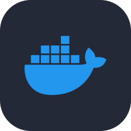</a>

<a href="https://fastapi.tiangolo.com">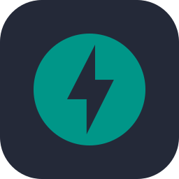</a>
<a href="https://www.gradio.app">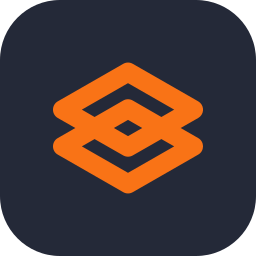</a>

<a href="https://pytest.org">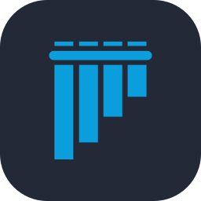</a>

<a href="https://langfuse.com">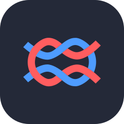</a>
<a href="https://mlflow.org">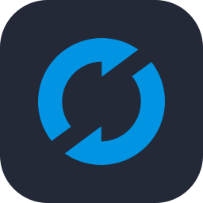</a> 

</td></tr>
</table>

## Certifications

<a href="https://www.credly.com/users/esam-mustafa-ali-abduljalil-al-areqi">View all verified badges on Credly →</a>

<b>All certifications (13)</b>

<table>
<tr><th width="68%"></th><th width="16%"></th><th width="16%"></th></tr>
<tr><td>AI Engineering Professional Certificate, incl. Generative AI Applications Specialist</td><td>IBM</td><td>Earned</td></tr>
<tr><td>AWS Certified AI Practitioner</td><td>AWS</td><td>Earned</td></tr>
<tr><td>GitHub Foundations</td><td>GitHub</td><td>Earned</td></tr>
<tr><td>Oracle Certified Foundations Associate</td><td>Oracle</td><td>Earned</td></tr>
<tr><td>Google AI Essentials Specialization</td><td>Google</td><td>Earned</td></tr>
<tr><td>Generative AI Applications</td><td>AWS</td><td>Earned</td></tr>
<tr><td>Java Foundations</td><td>Oracle Academy</td><td>Earned</td></tr>
<tr><td>Networking Devices and Initial Configuration</td><td>Cisco</td><td>Earned</td></tr>
<tr><td>SQL and Relational Databases</td><td>Online course</td><td>Earned</td></tr>
<tr><td>Memory for AI Applications, badge</td><td>MongoDB</td><td>Earned</td></tr>
<tr><td>Azure AI App and Agent Developer Associate (AI-103)</td><td>Microsoft</td><td>In progress</td></tr>
<tr><td>AWS Certified Cloud Practitioner</td><td>AWS</td><td>In progress</td></tr>
<tr><td>AWS Certified Machine Learning Engineer, Associate</td><td>AWS</td><td>In progress</td></tr>
</table>

## GitHub Activity


